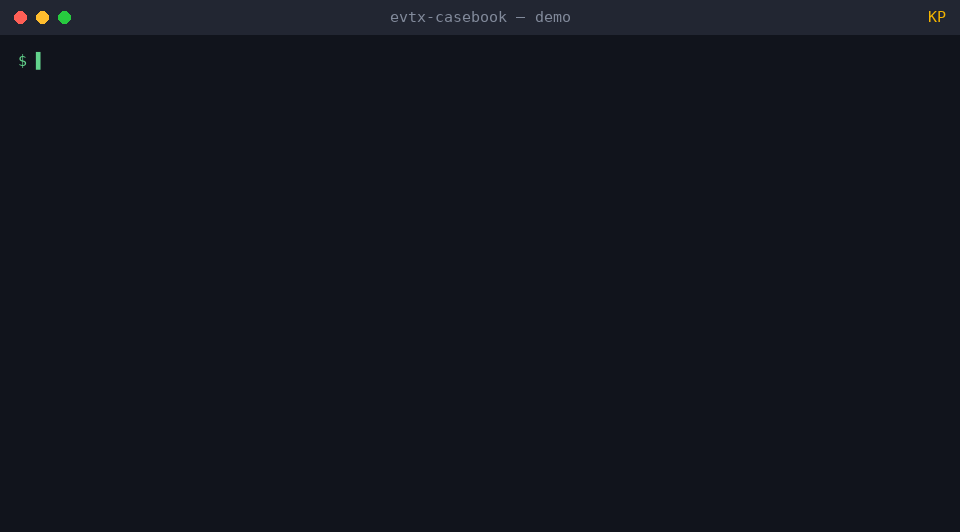
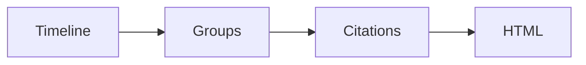

# EVTX Casebook


Built by Kanak Prabhakar

Reconstruct local sessions from exported Windows events with source citations and analyst notes.



The demo shows real output on the bundled public sample. Eight timeline rows become seven logon-session groups, and every record is still cited.

## Features and architecture
Read UTF-8 CSV or one JSON object per line. Require RecordID, index by computer, source and logon ID, escape all HTML, and retain unassigned records.



## Installation and usage
From the extracted project directory, run `python -m pip install -r requirements.txt` in a Python 3.11+ virtual environment. After setup the analysis runs offline.

```sh
python casebook.py public.csv case.html
python -m pytest -q 
python bench.py public.csv
```

## Benchmark protocol
Only use the public sample under Command and Control/DE_RDP_Tunneling_4624.evtx from EVTX-ATTACK-SAMPLES. Generate public.csv with Hayabusa dfir-timeline using the verbose profile, no wizard and UTC. Optional --notes notes.json accepts an object keyed by Computer|EvtxFile|RecordID (use Channel if EvtxFile is absent). For timed review use the same CSV in a spreadsheet and case.html in a browser. Start at file open. Identify the earliest timestamp, find the host with the most rows and cite every record for its most frequent logon ID. Stop at submission. Score correct answers and elapsed seconds separately. Alternate tool order between reviewers. No human timing has been measured.

| Input rows | Groups | Missing rows | Extra rows | Reviewer time |
|---:|---:|---:|---:|---|
| 8 | 7 | 0 | 0 | Not measured yet (protocol above) |

## Limitations and roadmap
Missing IDs fail explicitly. Logon IDs may recur after reboot and grouped evidence requires analyst review. Next add boot-boundary evidence.

## Resume line
Accomplished an offline Windows-event casebook that groups a public Hayabusa timeline into 7 logon sessions with 0 of 8 source records lost or invented, as measured by `bench.py` record-coverage counts, by doing host-, source- and logon-ID-scoped grouping with per-record citations and escaped HTML output.

The sample is small (8 rows from one public EVTX file). Coverage is exact on it, but it says nothing yet about analyst speed. Run the timed review protocol above before claiming a time saving. Record 5315 appears twice because two Hayabusa rules matched it. Both rows are kept and cited.

Open case.html for the prebuilt sample. SOURCES.md identifies the exact public sample and upstream revision.

## Credits
[Hayabusa](https://github.com/Yamato-Security/hayabusa), [EVTX-ATTACK-SAMPLES](https://github.com/sbousseaden/EVTX-ATTACK-SAMPLES), [pytest](https://pytest.org/).

## Presentation

1. I began with a public Hayabusa timeline in public.csv.
2. I preserved the host, source file and record number in casebook.py.
3. I grouped records with a logon ID and kept unattributed records separate.
4. I verified provenance and HTML escaping in test_casebook.py.
5. I compared the report with the source export using bench.py.

**Main limitation.** An identifier can recur after reboot. Group membership is a lead requiring analyst review.


See PRD.md, TRD.md and edge-cases.md for the design, and tests-output.txt for the latest pytest run.
